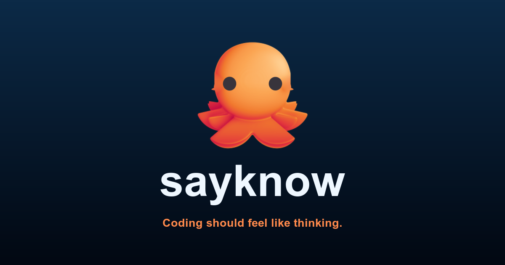

<p align="center">
  
</p>

<h1 align="center">Sayknow-CLI</h1>

<p align="center">
  <strong>Coding should feel like thinking.</strong><br />
  A focused coding-agent runner for interviews, reviewed plans, tmux-native execution, and durable verification.
</p>

<p align="center">
  <a href="https://github.com/jaybeyond/Sayknow_CLI/releases"></a>
  <a href="LICENSE"></a>
  <a href="https://github.com/jaybeyond/Sayknow_CLI/stargazers"></a>
  <a href="https://github.com/jaybeyond/Sayknow_CLI/issues"></a>
  <a href="https://bun.sh"></a>
  <a href="#languages"></a>
</p>

<p align="center">
  <b>English</b> ·
  <a href="docs/readme/README.ko.md">한국어</a> ·
  <a href="docs/readme/README.zh.md">中文</a> ·
  <a href="docs/readme/README.ja.md">日本語</a> ·
  <a href="docs/readme/README.es.md">Español</a> ·
  <a href="docs/readme/README.fr.md">Français</a> ·
  <a href="docs/readme/README.de.md">Deutsch</a>
</p>

<p align="center">
  
</p>

> Sayknow-CLI is an experimental, beta-stage project. Expect rough edges and verify outputs before relying on it for important work.

## Languages

The interface is localized into **7 languages** — English, 한국어 (Korean),
中文 (简体 / Simplified Chinese), 日本語 (Japanese), Español (Spanish),
Français (French), and Deutsch (German). It auto-detects your system locale on
first run; switch any time in **Settings → Appearance → Language**, or launch
with e.g. `LANG=ja_JP.UTF-8 skc`. Untranslated strings fall back to English, and
brand/technical names (Claude, OpenAI, protocol labels, …) stay verbatim across all locales.

## What is Sayknow-CLI?

Sayknow-CLI (`skc`) is an external coding-agent harness. It runs from the repository or worktree you choose, then gives the agent a small, explicit workflow surface:

```text
deep-interview -> ralplan -> ultragoal
                         └─ optional team execution when parallel tmux workers help
```

It is intentionally not a hidden plugin for Codex CLI, Claude Code, OpenCode, or Claw Code. Start `skc` beside those tools when you want structured planning, persistent evidence, tmux-backed workers, or an isolated worktree.

## Install

SKC runs on the [Bun](https://bun.sh) runtime, so install Bun first, then SKC:

```sh
# 1. Install Bun — the skc runtime (skip if you already have bun >= 1.3.14)
curl -fsSL https://bun.sh/install | bash   # Windows: powershell -c "irm bun.sh/install.ps1|iex"

# 2. Install skc, then verify
bun install -g sayknow-cli       # or: npm install -g sayknow-cli
skc --version
```

The package bundles prebuilt native addons for macOS (Intel + Apple Silicon),
Linux (x64/arm64), and Windows (x64), so there is **no Rust toolchain or build
step**. Bun is the one prerequisite: the `skc` launcher runs on Bun and will not
start without it.

### Upgrading

```sh
npm install -g sayknow-cli@latest    # or run `skc update` in your terminal
```

On startup `skc` shows an **Update Available** notice when a newer release exists.
Run `skc update` from your **terminal** (not inside an skc session) to fetch it.

> **Coming from an older source install?** If you installed earlier by cloning the
> repo, switch to the npm build once and updates become one-line from then on:
> ```sh
> rm -f ~/.local/bin/skc           # remove the old source-linked command
> npm install -g sayknow-cli
> ```

## Install from source (development)

For contributing or running unreleased code. Requires [Bun](https://bun.sh) **and**
a [Rust toolchain](https://rustup.rs) (`cargo`); the native addon is compiled locally.

```sh
git clone https://github.com/jaybeyond/Sayknow_CLI.git
cd Sayknow_CLI
bun install
bun run build:native              # compiles @sayknow-cli/natives (~1 min)
bun run install:dev               # links skc into ~/.local/bin + default skills
skc --version
```

Update a source checkout with `git pull && bun run build:native`. If `skc` is
"command not found", ensure `~/.local/bin` is on your `PATH`
(`echo 'export PATH="$HOME/.local/bin:$PATH"' >> ~/.zshrc && exec $SHELL`).

### Windows (native install)

On a clean Windows 11 machine, install Bun first, then build from source:

```powershell
# 1. Install Bun
powershell -c "irm bun.sh/install.ps1|iex"

# 2. Restart the terminal so PATH and the Bun runtime refresh, then confirm Bun
bun --version

# 3. Clone, bootstrap, and verify skc
git clone https://github.com/jaybeyond/Sayknow_CLI.git
cd Sayknow_CLI
bun run install:dev
skc --version
skc --smoke-test
```

`dev:link` places the `skc` launcher on your `PATH`. That directory must be on
`PATH` for `skc` to resolve as a command — restart PowerShell (or sign out/in)
if `skc` is "not recognized" after install.

Troubleshooting:

- **`skc` reports an old Bun runtime.** Re-run the Bun installer above, restart
  the terminal, and confirm `bun --version` matches what `skc --version`
  expects. If an older Bun still wins, make sure `%USERPROFILE%\.bun\bin` is
  first on `PATH` and remove any stale Bun installs shadowing it.
- **`skc.exe` exists but `skc` is "not recognized".** The launcher is installed
  but not on `PATH`. Confirm `%USERPROFILE%\.bun\bin` is listed in
  `echo $env:Path`, then restart the terminal.

## Quick start

```sh
# Run directly in the current checkout
skc

# Use a tmux-backed leader session
skc --tmux

# Use an isolated worktree for risky or reviewable work
# --worktree takes an optional branch-like name, not a filesystem path.
skc --tmux --worktree my-task-branch

# If you already created a worktree directory, launch from that directory instead.
cd ../my-task-worktree && skc --tmux
```

Inside a SKC session, use the public workflow surface:

```text
/skill:deep-interview clarify ambiguous requirements
/skill:ralplan build and critique the implementation plan
skc ultragoal create-goals --brief-file <approved-plan>
skc ultragoal complete-goals
```

Add `skc team ...` only when coordinated tmux workers materially help.

## Core capabilities

- **Interview before guessing**: `deep-interview` turns vague requests into concrete requirements.
- **Plan before mutation**: `ralplan` reviews the approach before code changes.
- **Execute with evidence**: `ultragoal` tracks goals, revisions, checks, and completion evidence.
- **Parallelize when useful**: `team` coordinates tmux-backed workers for larger tasks.
- **Stay external and reviewable**: run from a chosen repo or worktree without patching another agent runtime.
- **Keep going when a provider fails**: when the default model is blocked (no credentials, quota, auth or server errors) the session continues on a model from another provider; `/fallback` shows and edits that chain. A step interrupted by a restart or a transient failure resumes once on its own, on the same model. Quota answers such as Z.AI `1113` move on after one request instead of burning the retry budget.
- **Long sessions stay inside the context window**: after compaction, Codex starts from a fresh provider-visible baseline instead of growing toward `context_length_exceeded`, and compaction summaries are worded so providers do not refuse them.
- **Find code by meaning**: the `locate` tool finds where behaviour lives from a plain description when you have no name to grep for.
- **Route work to the right model**: `/model` assigns models per role and per detailed use; subagent tasks declare a `specialty` to land on the model you chose for that kind of work.
- **Ship from the session**: `github` and `gitlab` tools open and inspect pull/merge requests and CI without leaving SKC.
- **Prove the tests ran on this code**: the `verification-receipts` plugin stores a receipt for each test run and tells you when the code has changed since.
- **Come back to any session**: `alt+r` resume picker, `ctrl+q` to continue the latest, `/star`, `/fork`, `/rename`, and `/import-session` for Codex and Claude Code transcripts.

## Workflow surface

Sayknow-CLI ships four default workflow skills:

| Skill            | What it does                                                          |
| ---------------- | --------------------------------------------------------------------- |
| `deep-interview` | Clarifies ambiguous requirements before planning or code changes.     |
| `ralplan`        | Builds and critiques an implementation plan before mutation.          |
| `ultragoal`      | Tracks goals through execution, revision, verification, and evidence. |
| `team`           | Coordinates tmux-backed workers when parallel execution is worth it.  |

And four bundled role agents:

| Agent       | What it does                                       |
| ----------- | -------------------------------------------------- |
| `executor`  | Bounded implementation, fixes, and refactors.      |
| `architect` | Read-only architecture and code-review assessment. |
| `planner`   | Read-only sequencing and acceptance criteria.      |
| `critic`    | Read-only plan critique and actionability review.  |

No sprawling default skill zoo: SKC improves by making this small method better.

## Built-in tools

The agent works through these tools. Tools marked *opt-in* stay off until you enable them in **Settings → Tools** (or the listed key in `~/.skc/config.yml`).

| Area | Tools |
| ---- | ----- |
| Files and code | `read`, `write`, `edit`, `find`, `search`, `locate` (find code by description), `ast_grep` / `ast_edit` (syntax-aware search and rewrite), `lsp` |
| Shell and runtime | `bash`, `eval` (JS/Python cells), `ssh`, `debug`, `bisect`, `calc` |
| Delegation and tracking | `task` (subagents), `subagent`, `job`, `monitor`, `cron`, `irc` (talk to running agents), `todo_write`, `goal`, `checkpoint` / `rewind` |
| Git hosting | `github` (*opt-in*, `github.enabled`): pull requests, pushes, CI runs through `gh` · `gitlab` (*opt-in*, `gitlab.enabled`, needs [`glab`](https://gitlab.com/gitlab-org/cli)): `mr_create` (returns the open MR instead of a duplicate), `mr_view`, `mr_list`, `ci_status` for gitlab.com and self-hosted instances |
| Web and devices | `web_search`, `browser`, `computer`, `render_mermaid` |
| Discovery | `search_tool_bm25` (activates hidden and MCP tools on demand), `skill`, `skill_discovery`, `ask` |

Pick the tool set for one run with `--tools read,bash,...`; plugin, custom, and MCP tool names are accepted there too.

## Plugins

SKC loads plugin bundles (tools, hooks, skills, MCP servers) that are hash-checked at install time and quarantined if a file changes afterwards. Manage them with `skc plugin install|list|...`.

**`verification-receipts`** (bundled in this repository) answers "did the tests actually pass on the code that is there now?":

- `verification_run` runs explicit test files with `bun test` or `node --test` and stores an immutable receipt: per-file pass/fail counts plus a fingerprint of the working tree.
- `verification_status` recomputes that fingerprint without rerunning tests and reports `fresh` or `stale` once the code has changed.
- `verification_loop` and its hooks remind you when a background `task` finished without a fresh receipt.

It is advisory, POSIX-only, and needs Node 24.11.1+ for `node --test`. It is not part of the npm package; install it from a checkout:

```sh
git clone https://github.com/jaybeyond/Sayknow_CLI.git
skc plugin install ./Sayknow_CLI/packages/coding-agent/bundles/verification-receipts --user
```

## Works beside your existing agent or bot

| Tool or bot | Recommended SKC command | Boundary |
| ----------- | ----------------------- | -------- |
| Codex CLI | `skc --tmux --worktree <name>` or `skc` | `--worktree` names a SKC-managed sibling worktree; for an existing path, `cd` there first. |
| Claude Code | `skc --tmux` or `skc --tmux --worktree <name>` | SKC does not become a Claude Code extension. |
| OpenCode | `skc` or `skc --tmux` | External-runner workflow only today. |
| Claw Code | `skc --tmux --worktree <name>` | SKC does not install into or replace Claw Code. |
| External controller / bot | The Sayknow-CLI SDK ([`docs/sdk.md`](docs/sdk.md)); `skc --mode rpc` was removed | Compatible bots drive SKC through the documented SDK/coordinator contract, not scrollback scraping. |

For generic third-party bot setup and provider-independent smokes, see [`docs/bot-integration.md`](docs/bot-integration.md). For evaluating Aside as an opt-in search/context retrieval sidecar, see [`docs/aside-integration.md`](docs/aside-integration.md). For readiness classification across external-control surfaces, see [`docs/external-control-readiness.md`](docs/external-control-readiness.md). For lower-level protocol details, see [`docs/rpc.md`](docs/rpc.md) and [`docs/bridge.md`](docs/bridge.md). For the remote operator surfaces roadmap, see [`docs/sayknow-remote.md`](docs/sayknow-remote.md) (web steering wheel), [`docs/telegram-remote.md`](docs/telegram-remote.md) (Telegram lifecycle button), and [`docs/messenger-initiated-sessions.md`](docs/messenger-initiated-sessions.md) (future: start sessions from a messenger).

## Configuration

Provider retry, resume, and fallback behaviour lives in `~/.skc/config.yml` (values below are the defaults):

```yaml
retry:
  requestMaxRetries: 4
  streamMaxRetries: 100
  maxRetries: 3
  maxDelayMs: 300000
  autoResume: true          # resume an interrupted step once, on the same model
  maxSilentTimeouts: 3      # stop after this many timeouts with no output
fallback:
  auto: true                # continue on another logged-in provider when the default model is blocked
  maxAttempts: 3            # tries per model in the chain before moving on
```

`requestMaxRetries` applies before a stream is established. `streamMaxRetries` applies only to replay-safe transient stream failures. Invalid auth, unsupported models/providers, malformed requests, context overflow, user aborts, and permanent quota failures fail fast on the current model; with `fallback.auto` a blocked default model then hands over to the next model in the chain (`/fallback` shows and edits it).

## TUI identity

The default TUI identity is the SKC **ink-octopus** theme — octopus ink: warm graphite, paper text, one amber accent — for dark terminals, with **blue-octopus** for light terminals. A warm **red-octopus** variant is also bundled for those who prefer a darker, high-contrast palette. Three additional migration themes — `claude-code`, `codex`, and `opencode` — mirror the look of those tools for easy eye-migration and are selectable from Settings or `/theme`. Explicit user theme settings still win.

### Bundled theme grid

Pick from Settings (`Appearance -> Dark theme` / `Light theme`) or `/theme`.

| Theme | Visual feel | Best fit |
| --- | --- | --- |
| `blue-octopus` | Blue octopus palette with tentacle-blue accents. | Default for light terminals. |
| `red-octopus` | Warm red octopus variant with strong status contrast. | High-contrast dark alternative. |
| `ink-octopus` | Octopus ink — warm graphite background, paper text, one amber accent. | Default for dark terminals. |
| `glow-octopus` | Deep-sea bioluminescence — teal-black with glowing green and a violet secondary. | Dark terminals that want a vivid accent. |
| `violet-octopus` | Plum-dark with lavender accents and an apricot secondary. | Soft, colorful dark alternative. |
| `claude-code` | Claude Code-inspired dark palette with terracotta and pink highlights. | Claude Code muscle memory without leaving SKC. |
| `codex` | Crisp dark blue-gray palette with sharper coding-session contrast. | A Codex-like dark workspace. |
| `opencode` | OpenCode-inspired dark palette with punchier terminal accents. | OpenCode muscle memory in the bundled picker. |

## Development

Install dependencies, build native bindings, and set up local defaults:

```sh
bun install
bun run build:native
bun run install:defaults
```

The `.node` binary for `@sayknow-cli/natives` is gitignored and required before any CLI invocation (`install:defaults`, `dev:link`, tests).

### Canonical: build and link the dev `skc`

To make the global `skc` command run **this checkout's TypeScript source** (hot to every edit, with skills/natives working), link it onto your `PATH`:

```sh
bun install
bun run dev:link
```

`dev:link` symlinks `skc` → `packages/coding-agent/src/cli.ts` into `~/.local/bin` (override with `SKC_DEV_LINK_DIR`), replaces that managed target, warns and fails if another `skc` still shadows it earlier on `PATH`, and runs `--smoke-test` to confirm `@sayknow-cli/natives` loads. Use `bun run install:dev` for the full bootstrap (install + link + `setup defaults`).

Check at any time whether your `skc` has drifted (wrong source, or a compiled binary that can't load skills):

```sh
bun run dev:doctor
```

> Do **not** use the compiled binary for day-to-day development. `bun --cwd=packages/coding-agent run build` produces a standalone `dist/skc`, but a `bun build --compile` binary cannot dynamically load `@sayknow-cli/natives`, so skills fail with `Cannot find module '@sayknow-cli/natives' from '/$bunfs/root/skc'`. Running from source via `dev:link` avoids this. Build the binary only when validating a release.

Run the CLI from source directly without linking:

```sh
bun packages/coding-agent/src/cli.ts --help
```

Default workflow definitions live in source, not committed `.skc` copies:

```text
packages/coding-agent/src/defaults/skc/skills/<name>/SKILL.md
packages/coding-agent/src/prompts/agents/<role>.md
```

For workflow-definition or rebrand-surface changes, run the project gates:

```sh
bun scripts/check-visible-definitions.ts
bun scripts/verify-g002-gates.ts
bun scripts/rebrand-inventory.ts --strict
bun test packages/coding-agent/test/default-skc-definitions.test.ts
```

For a package-by-package map, see [`docs/codebase-overview.md`](docs/codebase-overview.md).

## Contributing

Contributions, bug reports, and release validation are welcome through GitHub Issues and Pull Requests.

## Inspirations and lineage

Sayknow-CLI's default TUI identity is the octopus family: ink-octopus as the dark default, blue-octopus as the light default, and warm red-octopus, glow-octopus, and violet-octopus alternates. It also bundles `claude-code`, `codex`, and `opencode` migration themes whose palettes are inspired by those tools so users moving from them get a familiar look. It builds on lessons from a small family of agent harnesses while keeping the public SKC surface intentionally focused. Historical attribution is kept in [`NOTICE.md`](NOTICE.md).

## License

MIT — Sayknow-CLI is an independent, MIT-licensed project. See [`LICENSE`](LICENSE).

Sayknow-CLI descends from the original MIT work of Mario Zechner and Can Bölük and has grown well beyond it with its own features, workflows, and brand. As the MIT License requires, the original authors' copyright is retained in [`LICENSE`](LICENSE); historical attribution lives in [`NOTICE.md`](NOTICE.md).
